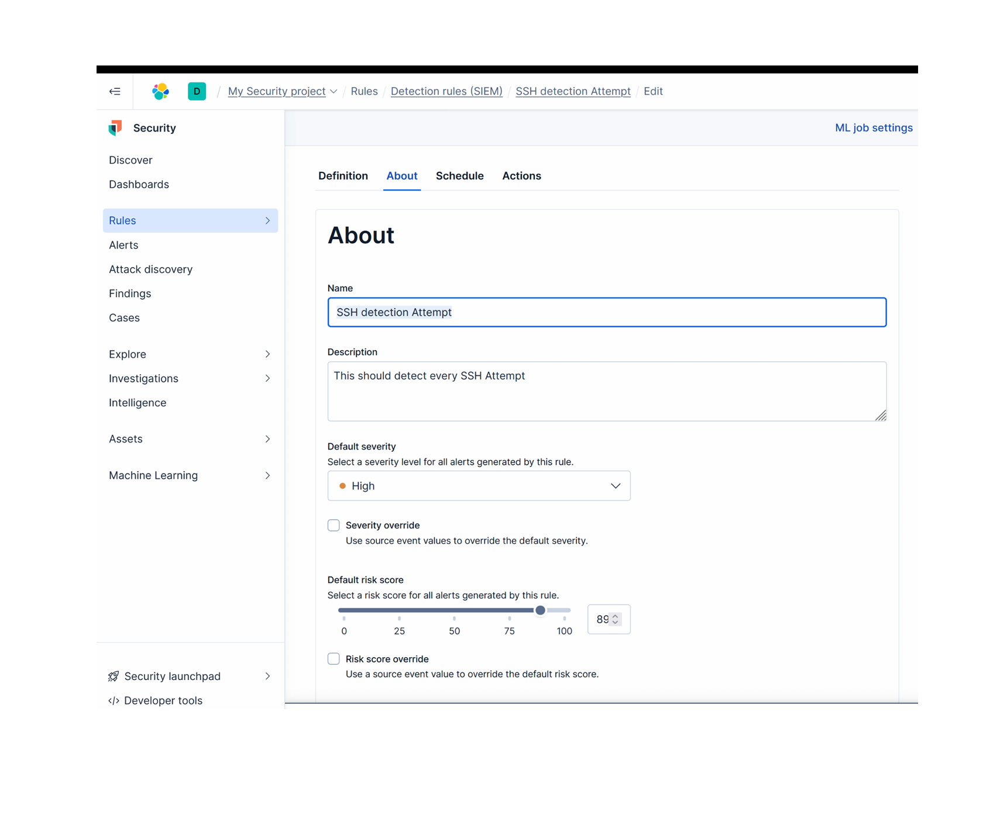
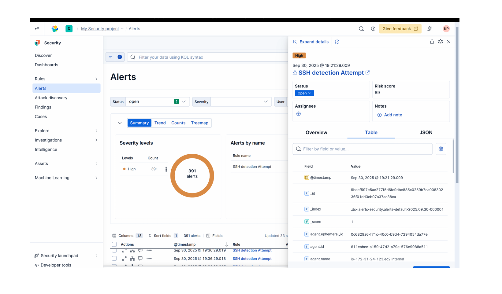

# INCIDENT-REPORT-UNAUTHORISED-SSH-ATTEMPT-TO-EC2-INSTANCE

## Summary

On **September 30, 2025**, Elastic SIEM detected and alerted on an unauthorized SSH access attempt to an EC2 instance in the organization's server. This activity violated the organizational security policy that prohibits SSH access in sensitive environments. The incident was investigated, contained, and mitigated.

 The original date i carried out this lab was September 2025, date of documentation is October, 2026. This lab was done as part of my capstone project for my Altschoolafrica diploma in cybersecurity ) 

## Timeline

| Time | Event |
|------|-------|
| 12:17 AM | Logs ingested from EC2 into Elastic SIEM |
| 12:21 AM | Custom SSH detection rule triggered |
| 12:21 AM | Alert raised in Elastic Security dashboard |
| 1:35 AM | Analyst triaged alert (verified via logs) |
| 8:31 PM | EC2 instance contained (isolated from network in Elastic SIEM) |

## Detection Method

Elastic SIEM, custom rule: **Prohibited Successful SSH Access**

## Impact / Severity

- **Severity:** Critical
- **Impact:** Potential unauthorized access and data exfiltration

  ## Triage

- Verified alert details in Elastic SIEM.
- Confirmed the source IP and target host via log data.
- Confirmed that SSH is a prohibited protocol in this environment.
- Rule matched on port 22/tcp.

**Conclusion:** This is indeed an unauthorized SSH attempt.

## Response

**Containment**

- Applied a restrictive Security Group to isolate the EC2 instance, blocking all non-essential traffic.
- Confirmed containment in the AWS console.
- Verified no further SSH connections were possible.

## Lessons Learned

- **Block SSH access** in security groups (use SSM Session Manager instead).
- **Harden IAM:** enforce MFA for admins and least privilege.
- **Continuous monitoring:** keep SIEM rules active for sensitive ports.
- **Threat intel integration (OTX):** helped validate suspicious activity.
